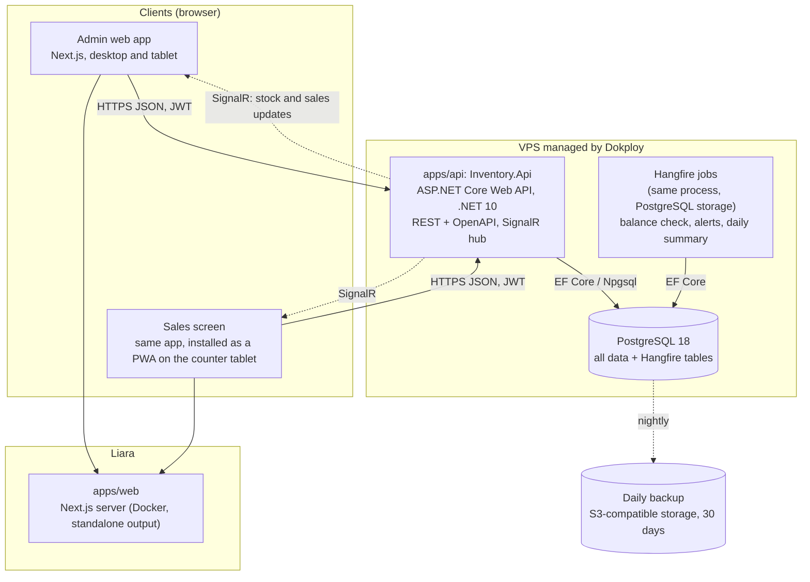
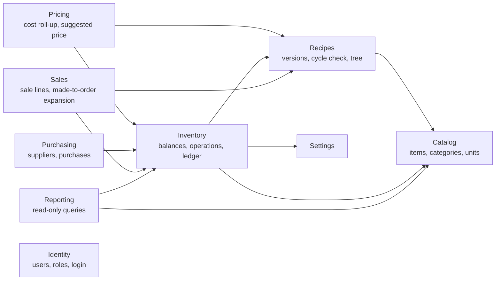
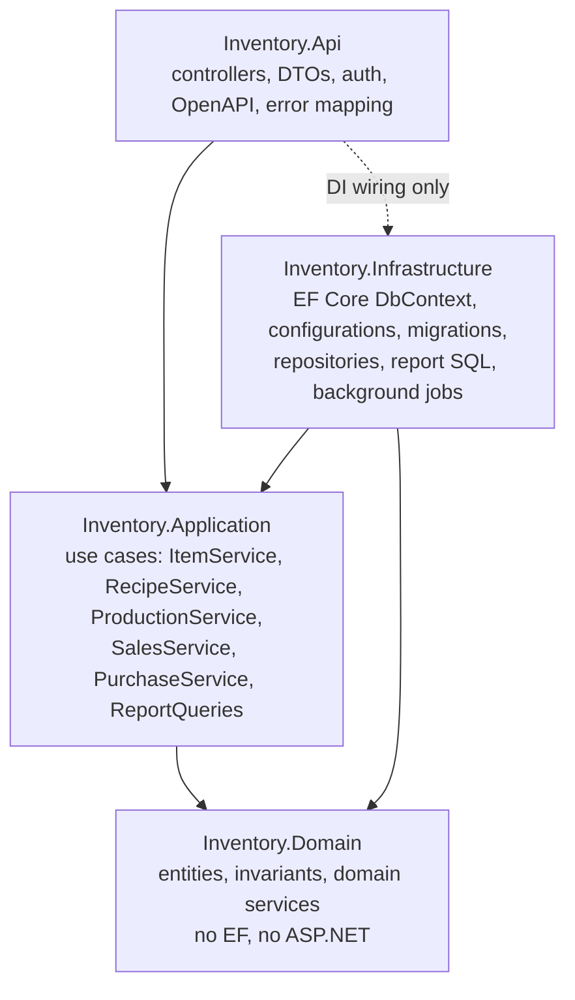
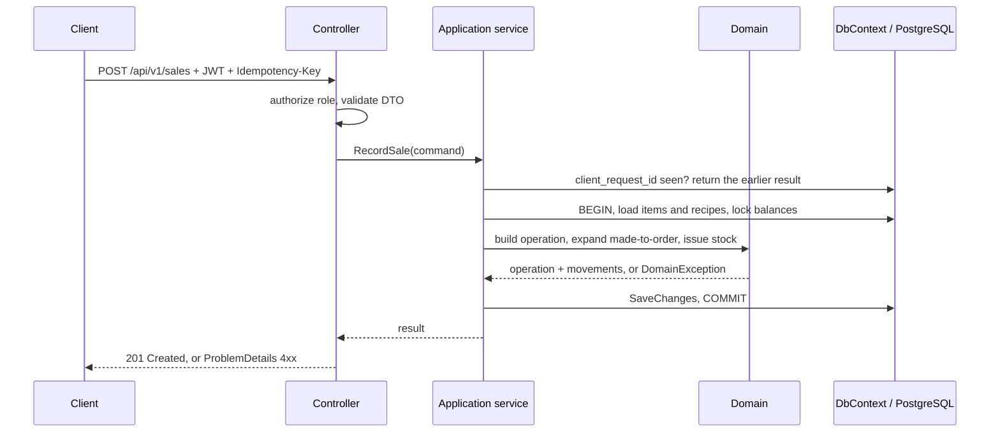
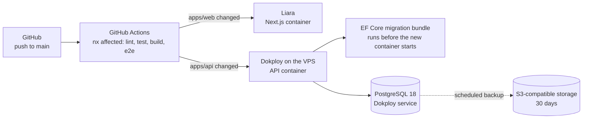

# 2. Architecture

## 2.1 Style: modular monolith with clean layers

One deployable ASP.NET Core application, split internally into **modules** (Catalog, Recipes, Inventory, Purchasing, Sales, Pricing, Reporting, Identity, Settings), each with clean layers.

**Why not microservices?** A production or sale must update items, recipes, balances and the ledger **in one database transaction**. Splitting these across services would turn a simple transaction into a distributed one. One cafeteria (or a few) needs no independent scaling. Clear module boundaries keep the option open later.

## 2.2 System context


## 2.3 Containers



The browser calls the API directly; the Next.js server only renders pages and never holds business logic. Every write still goes through the API, so roles, invariants and the ledger rules apply the same way to every client (web, tablet, and the AI assistant in Phase 2).

## 2.4 Modules and dependencies



Rules: no cycles between modules. Reporting only reads. **Inventory owns every write to balances and the ledger.** Purchasing, Production and Sales describe *what* should change, and Inventory's posting service applies it.

## 2.5 Layers and projects



The backend lives in `apps/api` of an **Nx monorepo** (pnpm workspaces), next to the web app and the shared TypeScript packages. Nx runs the .NET projects through the official `@nx/dotnet` plugin, so `nx affected` builds and tests only what changed, across C# and TypeScript.

```
inventory/
├── apps/
│   ├── api/                         → Dokploy (Dockerfile: apps/api/Dockerfile, build context: repo root)
│   │   ├── Inventory.sln
│   │   ├── src/
│   │   │   ├── Inventory.Domain/          Catalog/ Recipes/ Inventory/ Purchasing/ Pricing/ Common/
│   │   │   ├── Inventory.Application/     <Module>/ (commands, queries, services, interfaces)
│   │   │   ├── Inventory.Infrastructure/  Persistence/ (DbContext, Configurations/, Migrations/), Reporting/, Jobs/
│   │   │   └── Inventory.Api/             Controllers/, Contracts/ (DTOs), Hubs/ (SignalR), Program.cs
│   │   └── tests/
│   │       ├── Inventory.UnitTests/         domain rules, costing, pricing, cycle check
│   │       └── Inventory.IntegrationTests/  real PostgreSQL (Testcontainers): transactions, constraints, concurrency
│   └── web/                         → Liara (Dockerfile: apps/web/Dockerfile, Next.js standalone output)
├── packages/
│   ├── api-client/   → generated by orval from the API's OpenAPI document: React Query hooks + Zod schemas
│   ├── utils/        → money, quantity and Jalali date formatting shared by the UI
│   ├── ui-web/       → Tailwind components (RTL-safe)
│   └── config/       → tsconfig / eslint / tailwind presets
├── docs/                            → this design
├── graphify-out/                    → optional code knowledge graph for AI agents
├── docker-compose.yml               → local dev: PostgreSQL only
├── docker-compose.onprem.yml        → lifetime-license install on a café PC: api + web + PostgreSQL
├── nx.json
└── pnpm-workspace.yaml
```

- `packages/api-client` is never edited by hand. It is regenerated from `apps/api`'s OpenAPI document, so a changed DTO breaks the web build instead of failing at run time. orval also emits the Zod schemas, so there is no separate hand-written `types` package to drift.
- Shared packages are bundled into the apps at build time; they are not deployed on their own.
- Nx module boundary tags keep the rules visible: `scope:web`, `scope:api`, `scope:shared`, `type:ui`, `type:data-access`, `type:util`.

## 2.6 Life of a write request



## 2.7 Technology choices

The stack follows the team's standard Nx + ASP.NET Core stack, trimmed to what a cafeteria system needs ([ADR-018](09-decisions.md#adr-018)).

### Backend (`apps/api`)

| Concern | Choice | Reason |
|---|---|---|
| Runtime | .NET 10 (LTS), C# | Your choice. Long-term support until November 2028. |
| Web | ASP.NET Core Web API, controllers ([ADR-016](09-decisions.md#adr-016), accepted) | One controller per module, built-in validation, ProblemDetails, OpenAPI. Backend only; the UI is a separate client. |
| Data access | EF Core 10 + Npgsql | Migrations, LINQ, transactions. Raw SQL for heavy reports. |
| Database | PostgreSQL 18 | Strong constraints (partial unique, generated columns, check), `numeric`, `xmin` concurrency, free |
| API contract | Microsoft.AspNetCore.OpenApi + Swagger UI → orval client | The OpenAPI document is the contract the web client is generated from |
| Auth | ASP.NET Core Identity + JWT access token + rotating refresh token | Short-lived access token (about 15 minutes, kept in memory by the client); refresh token in an `HttpOnly; Secure; SameSite=Lax` cookie. Web and API share one parent domain (`app.<domain>`, `api.<domain>`) so the cookie is same-site. |
| Real-time | SignalR | Pushes stock, sale and alert changes to open dashboards and sales screens. One server needs no backplane. |
| Background jobs | Hangfire with PostgreSQL storage (`Hangfire.PostgreSql`) | Nightly balance = Σ movements check, low-stock and margin alerts, daily summary message. Retries and a run history; dashboard at `/hangfire` for the Owner only. No extra service. |
| Validation | Domain invariants + request DTO validation (FluentValidation) | Bad input is stopped at the edge; rules are enforced in the core |
| Logging | Serilog → console (structured JSON) | Dokploy collects container logs |
| Tests | xUnit + WebApplicationFactory + Testcontainers (PostgreSQL) | Real database for transaction, constraint and concurrency tests; never the EF in-memory provider |

### Web (`apps/web`)

| Concern | Choice | Reason |
|---|---|---|
| Framework | Next.js (App Router) + TypeScript | The team's standard web framework |
| Rendering | Client components for app screens; the server only renders the shell | Every screen is behind login, so there is nothing to server-render for SEO, and data comes from the API through React Query |
| Data | React Query via `packages/api-client` (orval) | Typed hooks, caching, retry with the same `Idempotency-Key` |
| Forms | React Hook Form + the generated Zod schemas | Client validation matches the API contract |
| Real-time | `@microsoft/signalr` | Live stock and sales on the dashboard and sales screen |
| Styling | Tailwind CSS v4 + `packages/ui-web` | Logical properties (`ms-`, `pe-`, `start-`) so the same components work RTL and LTR |
| Language and RTL | next-intl (fa, en), `dir="rtl"` for Persian, Vazirmatn through `next/font` | NFR-08 |
| Dates and numbers | `Intl` with `fa-IR-u-ca-persian` for Jalali display, date-fns-jalali for date arithmetic | Jalali reports (Q-6) without a custom calendar library |
| Charts | Recharts | Trend chart and dashboard (FR-RPT-08) |
| Animation | GSAP | Team standard; used sparingly in an operational app |
| PWA | Web app manifest + Serwist service worker | The counter tablet installs the sales screen like an app. The shell loads offline; recording a sale still needs the server (an offline sales queue is a later feature). |
| Unit tests | Vitest + Testing Library | |
| E2E tests | Playwright | Acceptance scenarios S-1 to S-5 through the real UI |

### Monorepo and tooling

| Concern | Choice | Reason |
|---|---|---|
| Monorepo | Nx + pnpm | One repo for API, web and shared packages |
| Nx plugins | `@nx/dotnet`, `@nx/next`, `@nx/playwright` | `@nx/dotnet` is the official .NET plugin (Nx 22+); it infers build and test targets from the `.csproj` files |
| CI | GitHub Actions: `nx affected -t lint test build e2e` | Only changed projects are checked |
| Build cache | Nx local cache, persisted between CI runs with `actions/cache` | No external cache service to depend on |
| AI tooling | Graphify (optional) | Code graph for AI agents. Builds and deploys never depend on it. |

## 2.8 Cross-cutting concerns

| Concern | Design |
|---|---|
| **Transactions** | One transaction per command (operation). The application service owns BEGIN and COMMIT. |
| **Concurrency** | Stock writes lock balance rows with `SELECT … FOR UPDATE` in item-id order (no deadlocks). Catalog edits use optimistic `xmin` tokens and return 409 on conflict. |
| **Idempotency** | Write endpoints take an `Idempotency-Key` header, stored as `client_request_id` (unique). A retry returns the original result. |
| **Errors** | Domain errors carry a stable `code` (`stock.insufficient`). The API returns RFC 9457 ProblemDetails with `code` and details (for example the list of shortages). 400 invalid input, 404 not found, 409 concurrency conflict or duplicate (name taken, request replayed with different body), 422 business-rule failure (insufficient stock, circular recipe, item has history). |
| **Time** | Store UTC. Inject `TimeProvider` for testability. Group reports in the business time zone. |
| **Money and quantities** | `decimal` everywhere, with the precision in [data model §3.5](03-data-model.md#35-precision-choices). |
| **IDs** | UUID v7 (time-ordered: good index locality, safe to generate in the client for offline use later). |
| **Security** | Role policies per endpoint (Owner, Supervisor, Staff). HTTPS. The database role used by the app has no UPDATE or DELETE on ledger tables. |
| **Background jobs** | Hangfire recurring jobs in the API process, stored in PostgreSQL: nightly balance = Σ movements check, low-stock and margin alerts, daily summary message (v1.1), report cache rebuild (later). Jobs call the same application services as the controllers. The web app runs no jobs. |
| **Real-time** | A SignalR hub in the API. After an operation commits, the API publishes "balances changed" and "sale recorded" events; clients refetch through React Query instead of trusting pushed numbers. |
| **CORS** | Only the web app's origin, with credentials (for the refresh cookie). |
| **Configuration** | `appsettings.json` + environment variables. Secrets come from environment or user-secrets, never from git. |

## 2.9 Deployment



| Target | Where | How |
|---|---|---|
| Web | Liara | Docker image from `apps/web/Dockerfile` (Next.js `output: "standalone"`), deployed by the Liara CLI in GitHub Actions only when `apps/web` or `packages/` change. Custom domain `app.<domain>`. |
| API | VPS + Dokploy | Auto-deploy on push to `main`, with a watch path on `apps/api`. Traefik (built into Dokploy) issues the HTTPS certificate for `api.<domain>`. |
| Database | Dokploy PostgreSQL service on the same VPS | Scheduled backups to S3-compatible storage, kept 30 days (NFR-07) |
| Lifetime-license café | The café's own PC | `docker compose -f docker-compose.onprem.yml up -d`: the same API and web images plus PostgreSQL. Backups go to a local folder; the café owns them. |

Server sizing: a VPS with 2 vCPU and 4 GB RAM runs Dokploy, the API and PostgreSQL for one café with room to spare. Firewall open on 22, 80 and 443 only; SSH keys only; regular OS updates.

Environments: **Development** (`docker compose up` for PostgreSQL, then `nx serve api` and `nx dev web`), and **Production**. Migrations run as an EF Core migration bundle (`dotnet ef migrations bundle`) in the deploy step, never automatically at app start.

## 2.10 Left out of the MVP stack, and when to add them

| Not used now | Add it when | Choice then |
|---|---|---|
| Redis | The API runs on more than one server (SignalR backplane) or a measured hot query needs a cache | Valkey (open-source, Redis-compatible) |
| Object storage (MinIO) | Items get photos or receipts are uploaded | Garage or SeaweedFS on Dokploy. MinIO's community edition stopped publishing Docker images in 2025. |
| Job queue in the web app (BullMQ) | Not planned. All jobs belong to the API, which owns the business rules and the database. | Hangfire |
| Nx Cloud | CI gets slow enough that a shared remote cache pays off | Nx Cloud or a self-hosted cache |
| Mobile app (Expo) and desktop app (Tauri) | A phase adds native features the PWA cannot do (push on iOS, hardware scanners, printers) | Expo for Android and iOS, Tauri v2 for Windows and macOS, both using `packages/api-client` |
