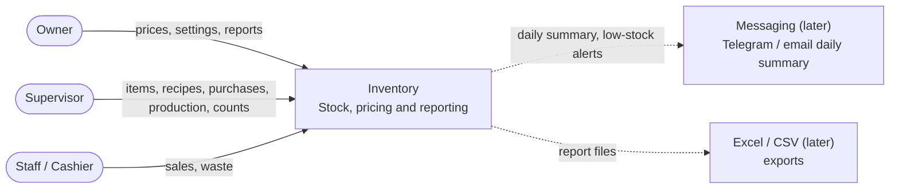
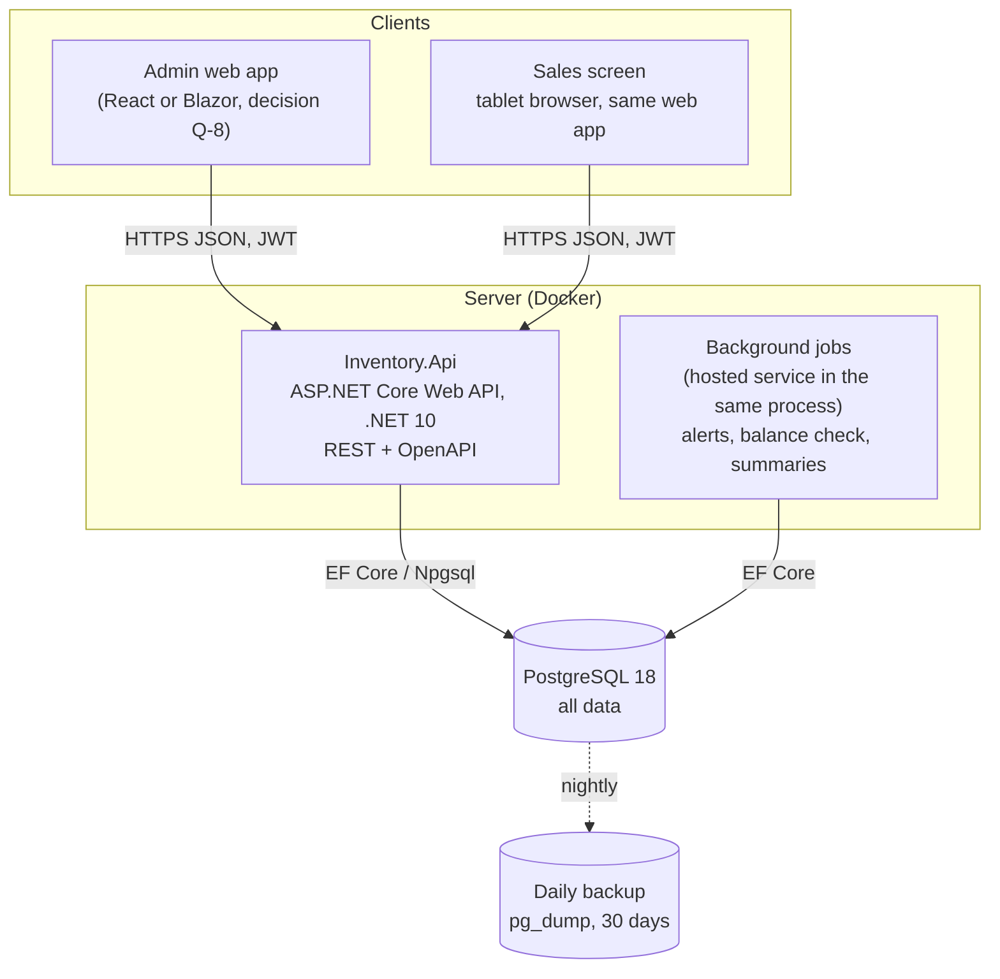
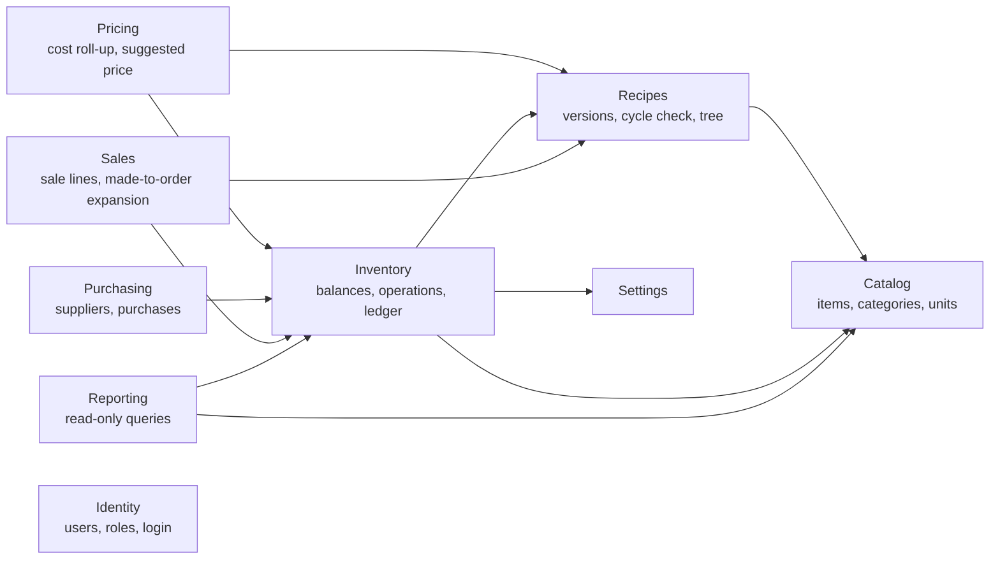
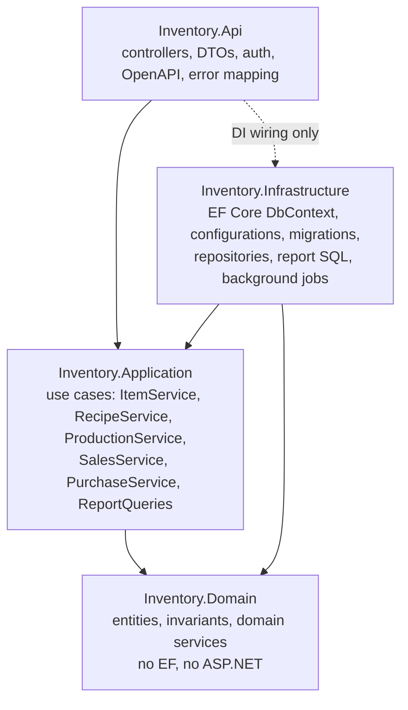
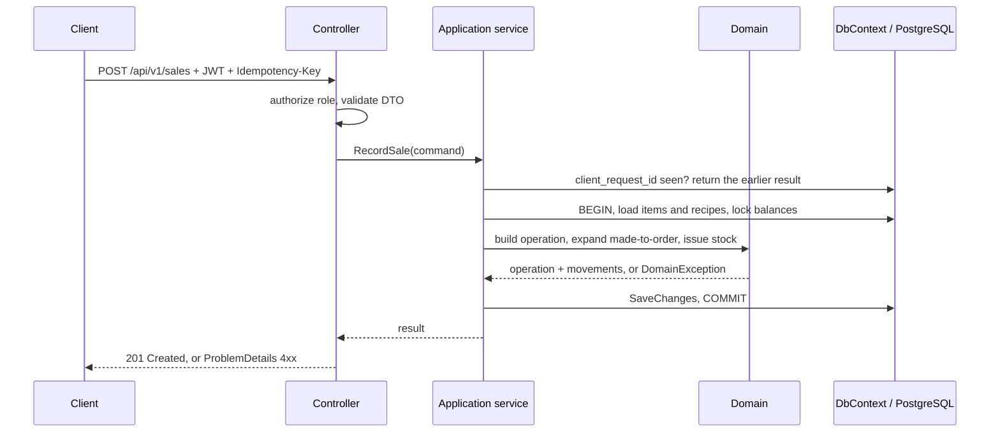
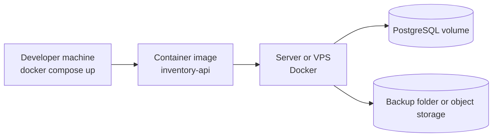

# 2. Architecture

## 2.1 Style: modular monolith with clean layers

One deployable ASP.NET Core application, split internally into **modules** (Catalog, Recipes, Inventory, Purchasing, Sales, Pricing, Reporting, Identity, Settings), each with clean layers.

**Why not microservices?** A production or sale must update items, recipes, balances and the ledger **in one database transaction**. Splitting these across services would turn a simple transaction into a distributed one. One cafeteria (or a few) needs no independent scaling. Clear module boundaries keep the option open later.

## 2.2 System context



## 2.3 Containers



## 2.4 Modules and dependencies



Rules: no cycles between modules. Reporting only reads. **Inventory owns every write to balances and the ledger.** Purchasing, Production and Sales describe *what* should change, and Inventory's posting service applies it.

## 2.5 Layers and projects



```
Inventory.sln
src/
  Inventory.Domain/          Catalog/ Recipes/ Inventory/ Purchasing/ Pricing/ Common/
  Inventory.Application/     <Module>/ (commands, queries, services, interfaces)
  Inventory.Infrastructure/  Persistence/ (DbContext, Configurations/, Migrations/), Reporting/, Jobs/
  Inventory.Api/             Controllers/, Contracts/ (request and response DTOs), Program.cs
tests/
  Inventory.UnitTests/         domain rules, costing, pricing, cycle check
  Inventory.IntegrationTests/  real PostgreSQL (Testcontainers): transactions, constraints, concurrency
```

## 2.6 Life of a write request



## 2.7 Technology choices

| Concern | Choice | Reason |
|---|---|---|
| Runtime | .NET 10 (LTS), C# | Your choice. Long-term support until 2028. |
| Web | ASP.NET Core Web API, controllers ([ADR-016](09-decisions.md#adr-016), accepted) | One controller per module, built-in validation, ProblemDetails, OpenAPI. Backend only; the UI is a separate client. |
| Data access | EF Core 10 + Npgsql | Migrations, LINQ, transactions. Raw SQL for heavy reports. |
| Database | PostgreSQL 18 | Strong constraints (partial unique, generated columns, check), `numeric`, `xmin` concurrency, free |
| API docs | Microsoft.AspNetCore.OpenApi + Swagger UI | Built in for .NET 10 |
| Auth | JWT bearer tokens, ASP.NET Core Identity password hasher | Simple, stateless; works for web and tablet |
| Validation | Domain invariants + request DTO validation (FluentValidation or DataAnnotations) | Bad input is stopped at the edge; rules are enforced in the core |
| Logging | Serilog → console + file (structured) | Cheap, searchable |
| Tests | xUnit, Testcontainers (PostgreSQL), FluentAssertions-style assertions | Real database for transaction and constraint tests |
| Packaging | Docker Compose: api + postgres | One command to run anywhere |

## 2.8 Cross-cutting concerns

| Concern | Design |
|---|---|
| **Transactions** | One transaction per command (operation). The application service owns BEGIN and COMMIT. |
| **Concurrency** | Stock writes lock balance rows with `SELECT … FOR UPDATE` in item-id order (no deadlocks). Catalog edits use optimistic `xmin` tokens and return 409 on conflict. |
| **Idempotency** | Write endpoints take an `Idempotency-Key` header, stored as `client_request_id` (unique). A retry returns the original result. |
| **Errors** | Domain errors carry a stable `code` (`stock.insufficient`). The API returns RFC 9457 ProblemDetails with `code` and details (for example the list of shortages). 400 invalid input, 404 not found, 409 concurrency conflict or duplicate (name taken, request replayed with different body), 422 business-rule failure (insufficient stock, circular recipe, item has history). |
| **Time** | Store UTC. Inject `TimeProvider` for testability. Group reports in the business time zone. |
| **Money and quantities** | `decimal` everywhere, with the precision in [data model §3.5](03-data-model.md#35-precision-choices). |
| **IDs** | UUID v7 (time-ordered: good index locality, safe to generate in the client for offline use later). |
| **Security** | Role policies per endpoint (Owner, Supervisor, Staff). HTTPS. The database role used by the app has no UPDATE or DELETE on ledger tables. |
| **Background jobs** | Hosted services: nightly balance = Σ movements check, low-stock and margin alerts, report summaries (later). |
| **Configuration** | `appsettings.json` + environment variables. Secrets come from environment or user-secrets, never from git. |

## 2.9 Deployment



Environments: **Development** (local Docker), and **Production** (a single VPS or the cafeteria's PC). Migrations are applied by a deploy step, never automatically at app start in production.
