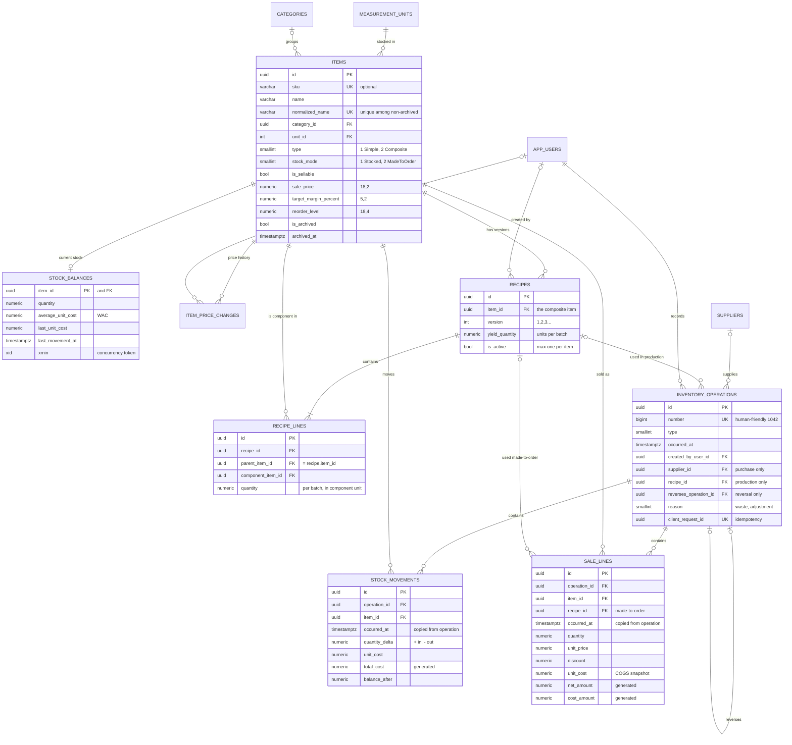

# 3. Data Model (the data structure)

This is the core of the design. Every feature (inventory, pricing, statistics) is a read of, or an append to, these tables.

**Design principles**

1. **One `items` table** for every ingredient, product and bundle.
2. **Composition is a self-referencing link** from `items` to `items` (through `recipe_lines`), and recipes are versioned.
3. **The ledger is append-only.** Stock is changed only by adding `stock_movements` under an `inventory_operations` header. Nothing in the ledger is ever updated or deleted.
4. **`stock_balances` is a cache** of the ledger, kept for fast reads. It always equals the sum of the movements.
5. **The database enforces the rules it can** (foreign keys, unique keys, check constraints), so a bug in application code cannot corrupt the data.
6. **Money and quantities are `numeric`.** Never floating point.

## 3.1 Entity-relationship diagram

The smaller tables (`measurement_units`, `categories`, `item_price_changes`, `suppliers`, `app_users`, `business_settings`) are specified in §3.3.

## 3.2 How the pieces fit: the cake example as rows

**Items**

| name | type | stock_mode | unit | sale_price |
|---|---|---|---|---|
| Flour | Simple | Stocked | kg | — |
| Sugar | Simple | Stocked | kg | — |
| Egg | Simple | Stocked | pc | — |
| Butter | Simple | Stocked | kg | — |
| Cake | Composite | Stocked | pc | — |
| Piece of Cake | Composite | Stocked | slice | 29,000 |
| Bottle of Tea | Simple | Stocked | btl | 20,000 |
| Tea + Cake | Composite | **MadeToOrder** | pc | 44,000 |

**Recipes and lines**

| recipe | version | yield | component → quantity |
|---|---|---|---|
| Cake | v1 (active) | 1 | Flour 0.5 · Sugar 0.3 · Egg 4 · Butter 0.2 |
| Piece of Cake | v1 (active) | **8** | Cake 1 (one cake gives 8 slices) |
| Tea + Cake | v1 (active) | 1 | Piece of Cake 1 · Bottle of Tea 1 |

Tea + Cake **reuses** the existing Piece of Cake and Bottle of Tea items. Nothing is copied, as v0.1 required.

**One production operation (#1042: make 2 cakes)**: one header and five movements

| item | quantity_delta | unit_cost | total_cost | balance_after |
|---|---|---|---|---|
| Flour | −1.0 | 42,000 | −42,000 | 9.0 |
| Sugar | −0.6 | 30,000 | −18,000 | 4.4 |
| Egg | −8 | 5,000 | −40,000 | 22 |
| Butter | −0.4 | 200,000 | −80,000 | 1.6 |
| Cake | **+2** | **90,000** | +180,000 | 2 |

The value of the components consumed (180,000) equals the value of the cakes produced. Production moves value from one item to another; it creates no profit.

## 3.3 Table specifications

Conventions: table and column names are `snake_case`. `id` is `uuid` (UUID v7, which sorts by time). Every mutable table has `created_at` and `updated_at` (`timestamptz`, UTC). PK = primary key, FK = foreign key, UK = unique, CK = check constraint.

### `measurement_units` (reference data, seeded)

| Column | Type | Rules |
|---|---|---|
| id | int | PK (fixed seed ids) |
| code | varchar(16) | UK. g, kg, ml, l, pc, btl, cup, pack, slice |
| name | varchar(64) | |
| dimension | smallint | 1 Count, 2 Mass, 3 Volume |
| factor_to_base | numeric(18,6) | CK > 0. Base units: g = 1, kg = 1000, ml = 1, l = 1000, count units = 1 |

Conversion is allowed only within the same dimension. Each item is stocked in exactly one unit, and all its quantities are in that unit.

### `categories`

| Column | Type | Rules |
|---|---|---|
| id | uuid | PK |
| name | varchar(100) | |
| normalized_name | varchar(100) | UK (upper-cased, so names are case-insensitive) |
| sort_order | int | |

### `items`

| Column | Type | Null | Rules |
|---|---|---|---|
| id | uuid | | PK |
| sku | varchar(64) | ✓ | UK where not null. Upper-cased. |
| name | varchar(200) | | |
| normalized_name | varchar(200) | | UK **where `is_archived = false`**, so an archived "Muffin" doesn't block a new one |
| description | varchar(1000) | ✓ | |
| category_id | uuid | ✓ | FK → categories, ON DELETE SET NULL |
| unit_id | int | | FK → measurement_units, RESTRICT |
| type | smallint | | CK in (1 Simple, 2 Composite). Cannot change after creation. |
| stock_mode | smallint | | CK in (1 Stocked, 2 MadeToOrder) |
| is_sellable | bool | | |
| sale_price | numeric(18,2) | ✓ | CK ≥ 0 |
| target_margin_percent | numeric(5,2) | ✓ | CK 0 ≤ x < 100. Null means use the default from settings. |
| reorder_level | numeric(18,4) | ✓ | CK ≥ 0 |
| is_archived | bool | | |
| archived_at | timestamptz | ✓ | |
| xmin | xid | | Concurrency token (system column) |

Table-level checks:
- `ck_items_mto_composite`: `stock_mode = 1 OR type = 2`. Only composite items can be made to order.
- `ck_items_sellable_price`: `NOT is_sellable OR sale_price IS NOT NULL`. You can't sell an item without a price.
- `ck_items_archived`: `is_archived = (archived_at IS NOT NULL)`.

Indexes: `category_id`; `(is_archived, type)` for the catalog filters.

### `item_price_changes`

| Column | Type | Rules |
|---|---|---|
| id | uuid | PK |
| item_id | uuid | FK → items, CASCADE |
| old_price, new_price | numeric(18,2) | null means no price |
| changed_at | timestamptz | |
| changed_by_user_id | uuid | FK → app_users |

Index `(item_id, changed_at DESC)`.

### `recipes`

| Column | Type | Rules |
|---|---|---|
| id | uuid | PK |
| item_id | uuid | FK → items, RESTRICT. The item must be Composite (checked in the application). |
| version | int | CK ≥ 1. UK `(item_id, version)` |
| yield_quantity | numeric(18,4) | CK > 0 |
| is_active | bool | Partial UK on `item_id` **where `is_active`**: at most one active version per item |
| notes | varchar(1000) | |
| created_at, created_by_user_id | | Recipes are immutable, so there is no `updated_at` |

Alternate key `(id, item_id)` is the target of the composite foreign key from `recipe_lines`.

### `recipe_lines` (the self-referencing composition)

| Column | Type | Rules |
|---|---|---|
| id | uuid | PK |
| recipe_id | uuid | |
| parent_item_id | uuid | Copy of `recipes.item_id` |
| component_item_id | uuid | FK → items, RESTRICT |
| quantity | numeric(18,4) | CK > 0. Per batch, in the component's unit. |

- FK `(recipe_id, parent_item_id)` → `recipes(id, item_id)` ON DELETE CASCADE. This guarantees `parent_item_id` always matches the recipe's item.
- `ck_recipe_lines_not_self`: `parent_item_id <> component_item_id`. An item is never its own component.
- UK `(recipe_id, component_item_id)`: each component appears once per recipe.
- Index `component_item_id`, for the "where used" lookup and the cycle check.

*Why copy `parent_item_id`?* PostgreSQL check constraints can only see their own row. Copying the parent into each line, and pinning it with the composite FK, lets the **database** block self-reference. Longer cycles (A → B → A) need a graph walk, which runs in the application (see [domain model](04-domain-model.md#43-domain-services)).

### `suppliers`

| Column | Type | Rules |
|---|---|---|
| id | uuid | PK |
| name | varchar(200) | |
| phone | varchar(32) | |
| notes | varchar(1000) | |
| is_archived | bool | |

### `stock_balances` (cache of the ledger)

| Column | Type | Rules |
|---|---|---|
| item_id | uuid | PK, FK → items, RESTRICT |
| quantity | numeric(18,4) | Must not go negative unless the setting allows it (checked in the application) |
| average_unit_cost | numeric(19,6) | CK ≥ 0. Weighted average cost. |
| last_unit_cost | numeric(19,6) | Last purchase or production cost. Used for costing when quantity is 0. |
| last_movement_at | timestamptz | For "not moved in 30 days" reports |
| xmin | xid | Concurrency token |

There is one row per **stocked** item, created at the first movement. Made-to-order items never have a row.
Index `(quantity)` is not needed. The low-stock query joins on `items.reorder_level`, and there are few enough items to filter in memory.

### `inventory_operations` (ledger header)

| Column | Type | Null | Rules |
|---|---|---|---|
| id | uuid | | PK |
| number | bigint | | Identity, UK. Shown to users as "#1042". |
| type | smallint | | 1 Purchase, 2 Production, 3 Sale, 4 Waste, 5 Adjustment, 6 StockCount, 7 Reversal |
| occurred_at | timestamptz | | When it happened. Reports group by this column. |
| created_at | timestamptz | | When it was entered. Can differ from occurred_at when entered late. |
| created_by_user_id | uuid | | FK → app_users |
| supplier_id | uuid | ✓ | FK → suppliers |
| recipe_id | uuid | ✓ | FK → recipes (the version used) |
| reverses_operation_id | uuid | ✓ | FK → inventory_operations, UK (an operation can be reversed only once) |
| reason | smallint | ✓ | 1 OpeningBalance, 2 Expired, 3 Damaged, 4 Spilled, 5 StaffMeal, 6 Theft, 7 CountCorrection, 99 Other |
| reference | varchar(100) | ✓ | Supplier invoice number or receipt number |
| note | varchar(1000) | ✓ | |
| client_request_id | uuid | ✓ | UK. Idempotency key from the client, so a retried POST does not double-post. |

Checks:
- `supplier_id IS NULL OR type = 1`
- `(type = 2) = (recipe_id IS NOT NULL)`: production always records its recipe version.
- `(type = 7) = (reverses_operation_id IS NOT NULL)`
- `type NOT IN (4, 5) OR reason IS NOT NULL`: waste and adjustments need a reason.

Indexes: `occurred_at`; `(type, occurred_at)`.

### `stock_movements` (ledger lines)

| Column | Type | Rules |
|---|---|---|
| id | uuid | PK |
| operation_id | uuid | FK → inventory_operations |
| item_id | uuid | FK → items, RESTRICT (this is what blocks deleting an item with history) |
| occurred_at | timestamptz | Copied from the operation, so per-item history and reports need no join |
| quantity_delta | numeric(18,4) | CK ≠ 0 |
| unit_cost | numeric(19,6) | CK ≥ 0. Price paid for purchases; WAC at that moment for everything else. |
| total_cost | numeric(22,4) | **Generated** `quantity_delta * unit_cost` (stored) |
| balance_after | numeric(18,4) | Running balance, so the item ledger screen needs no window function |

Index `(item_id, occurred_at)`. The table is append-only: application code never runs UPDATE or DELETE on it.

### `sale_lines` (the commercial side of a sale)

| Column | Type | Rules |
|---|---|---|
| id | uuid | PK |
| operation_id | uuid | FK → inventory_operations (type Sale, or Reversal of a sale) |
| item_id | uuid | FK → items |
| recipe_id | uuid | FK → recipes, null. The version consumed, for made-to-order items. |
| occurred_at | timestamptz | Copied from the operation |
| quantity | numeric(18,4) | CK ≠ 0. **Negative only on reversal (refund) lines.** |
| unit_price | numeric(18,2) | CK ≥ 0. Defaults to `items.sale_price`, but is stored, so later price changes don't rewrite history. |
| discount | numeric(18,2) | Same sign as quantity. CK `abs(discount) <= abs(quantity * unit_price)` |
| unit_cost | numeric(19,6) | CK ≥ 0. COGS snapshot per unit. |
| net_amount | numeric(18,2) | **Generated** `quantity * unit_price - discount` |
| cost_amount | numeric(22,4) | **Generated** `quantity * unit_cost` |

Index `(item_id, occurred_at)`; `(occurred_at)`.

*Why separate from movements?* Selling a made-to-order latte earns revenue for the latte, but the stock movements are for milk and coffee. Revenue lives on the item the customer bought, and stock lives on the items that physically left the shelf.

### `app_users`

| Column | Type | Rules |
|---|---|---|
| id | uuid | PK |
| user_name | varchar(64) | UK (normalized) |
| display_name | varchar(100) | |
| password_hash | varchar(256) | ASP.NET Core Identity hasher (PBKDF2) |
| role | smallint | 1 Owner, 2 Supervisor, 3 Staff |
| is_active | bool | Users are deactivated, never deleted, because the ledger references them |

### `business_settings` (single row)

| Column | Type | Default |
|---|---|---|
| id | smallint | PK, CK `id = 1` |
| currency_code | varchar(3) | `IRR` (confirm Q-7) |
| time_zone | varchar(64) | `Asia/Tehran` (confirm) |
| week_starts_on | smallint | 6 = Saturday (0 Sunday to 6 Saturday) |
| calendar | smallint | 1 Gregorian, 2 Jalali (confirm Q-6) |
| default_target_margin_percent | numeric(5,2) | 60 |
| price_rounding_step | numeric(18,2) | 1000 |
| allow_negative_stock | bool | false |

## 3.4 Rules the database enforces, and rules the application enforces

| Rule | Where |
|---|---|
| Quantities > 0 in recipes, yield > 0 | DB check |
| One component once per recipe | DB unique |
| Item is not its own component | DB check (via `parent_item_id`) |
| No longer cycles (A → B → A) | Application: graph walk before saving or activating a recipe |
| One active recipe per item | DB partial unique |
| Only composite items have recipes; only composite items are made-to-order | Application + DB check on `items` |
| Sellable needs a price | DB check |
| Item with history cannot be deleted | DB FK RESTRICT (the application checks first for a friendly message) |
| Operation is all-or-nothing | Application: one DB transaction per operation |
| No negative stock (unless allowed) | Application, inside the transaction, with locked balance rows |
| Balance = Σ movements | Application writes both in the same transaction. A nightly job verifies it. |
| Ledger is never updated or deleted | Application convention + DB permission (the app's DB role has no UPDATE/DELETE grant on ledger tables) |
| Same request not posted twice | DB unique on `client_request_id` |

## 3.5 Precision choices

| Kind | Type | Example |
|---|---|---|
| Quantity | numeric(18,4) | 0.125 cake, 12.5 g |
| Unit cost | numeric(19,6) | Syrup bought at 250,000 per 0.7 l bottle, stocked in ml = 357.142857 per ml |
| Price, money total | numeric(18,2) | 44,000.00 |
| Cost total | numeric(22,4) | quantity × unit cost without rounding loss |
| Percent | numeric(5,2) | 62.50 |

## 3.6 Planned extensions (designed so they need no restructuring)

| Extension | Change |
|---|---|
| Storage locations (fridge, store room) | New `storage_locations`. Add `location_id` to `stock_balances` (PK becomes `(item_id, location_id)`) and to `stock_movements`. New operation type Transfer. |
| Lots and expiry dates | New `stock_lots (id, item_id, expires_at, quantity)`. Movements get an optional `lot_id`. Issue first-expiry-first-out. |
| Purchase units ("box of 30 eggs") | New `item_purchase_units (item_id, name, quantity_in_stock_unit)`. |
| Report cache | New `daily_item_summaries (day, item_id, qty_sold, revenue, cogs, purchases, waste)`, rebuilt from the ledger. |
| Multi-branch | Add `branch_id` to operations, balances and settings. |
