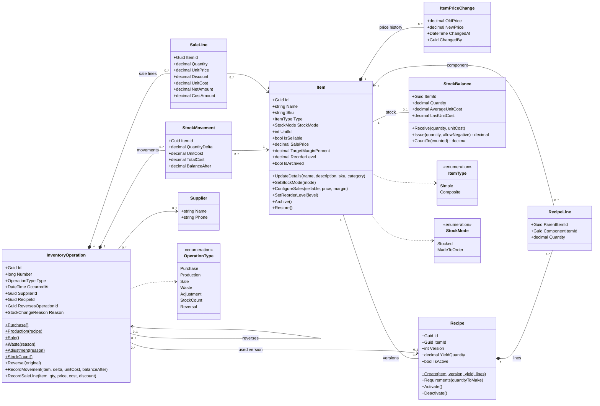
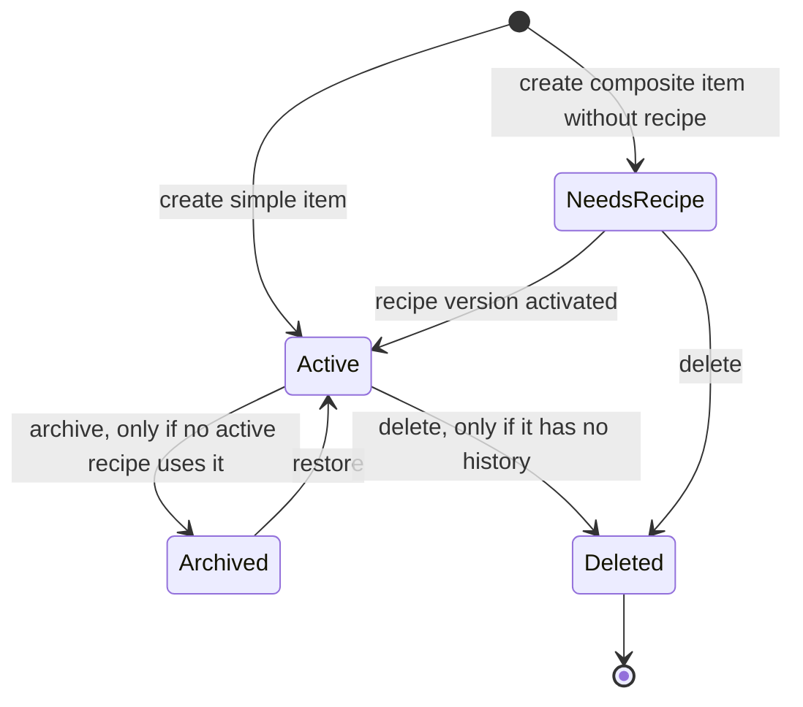
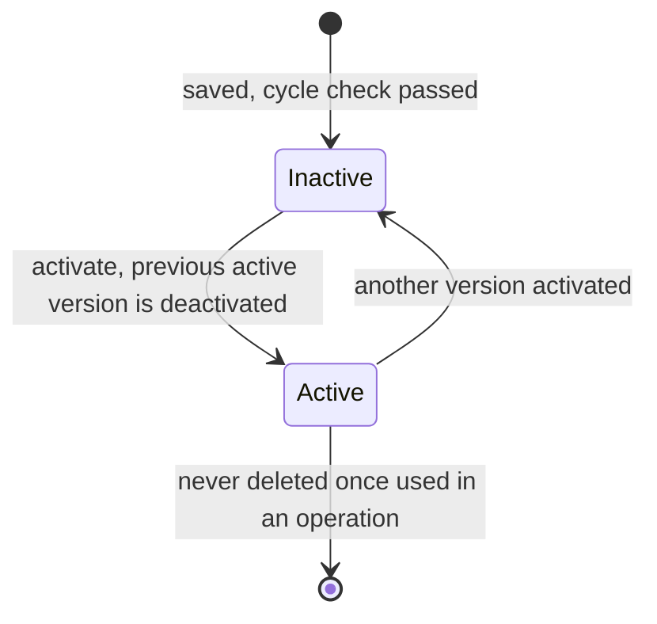
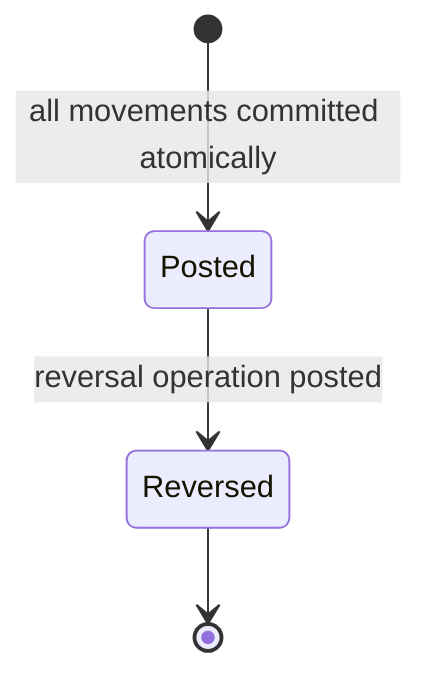

# 4. Domain Model (business model)

The domain model is the set of business objects and the rules they protect. The [data model](03-data-model.md) is how those objects are stored; this document is how they **behave**.

## 4.1 Aggregates

An aggregate is a group of objects that is always saved together and always kept consistent.

| Aggregate | Contains | Protects |
|---|---|---|
| **Item** | Item, price history | Name rules, stock-mode rules, price ≥ 0, margin range, archive state |
| **Recipe** | Recipe, recipe lines | At least one line, positive quantities, no duplicates, no self-reference, immutable once created |
| **InventoryOperation** | Operation, stock movements, sale lines | Type-specific fields (supplier only on purchases…), non-zero movements, discount ≤ line amount |
| **StockBalance** | One row per stocked item | WAC calculation, no negative stock (unless allowed), concurrency |
| **Supplier**, **Category**, **User**, **Settings** | Themselves | Simple field rules |

## 4.2 Class diagram

## 4.3 Domain services

These are pure business logic. They have no database or HTTP code, so each can be unit-tested on its own.

| Service | Responsibility | Inputs → output |
|---|---|---|
| **RecipeGraph** | Detects cycles before a recipe is saved or activated | parent, new components, "components of X" lookup → cycle path or none |
| **RecipeExploder** | Expands made-to-order items recursively into the stocked items that must actually leave the shelf | item, quantity → list of (stocked item, quantity) |
| **StockPosting** | Applies a list of requested changes to balances, issuing at WAC and receiving at the given cost, and emits the movements | balances, changes → movements, or a shortage list |
| **CostRollup** | Unit cost of any item, by walking the recipe tree down to simple items | item, "cost info of X" lookup → cost + items with unknown cost |
| **PriceSuggestion** | Suggested price from cost, target margin and rounding step; actual margin of a price | cost, margin, step → price |
| **ProductionCapacity** | "What can I make?": maximum producible quantity and the limiting component | recipe tree, balances → quantity, bottleneck |

## 4.4 Invariants catalogue

Each rule has an ID that is used in tests and error codes.

| ID | Rule | Error code |
|---|---|---|
| INV-01 | Item name is required, ≤ 200 characters, and unique among non-archived items (case-insensitive) | `item.name.required`, `item.name.duplicate` |
| INV-02 | Item type cannot change after creation | `item.type.immutable` |
| INV-03 | Only composite items can be made-to-order or have a recipe | `item.made_to_order_requires_composite`, `recipe.item_not_composite` |
| INV-04 | A sellable item must have a sale price ≥ 0 | `item.sale_price.required` |
| INV-05 | Target margin is between 0 (inclusive) and 100 (exclusive) | `item.target_margin_out_of_range` |
| INV-06 | Unit can change only while the item has no movements | `item.unit.locked` |
| INV-07 | A recipe has ≥ 1 line, every quantity > 0, yield > 0, and each component once | `recipe.lines_required`, `recipe.line_quantity.not_positive`, `recipe.duplicate_component` |
| INV-08 | No item is its own component, directly or through any chain | `recipe.circular` |
| INV-09 | Recipe components must be active (not archived) items | `recipe.component_archived` |
| INV-10 | At most one active recipe version per item. Producing or selling a composite item needs an active recipe. | `recipe.none_active` |
| INV-11 | An item used by an active recipe cannot be archived | `item.in_use` (lists the parents) |
| INV-12 | An item with any movements, sale lines or recipe usage cannot be hard-deleted | `item.has_history` |
| INV-13 | Made-to-order items never hold stock, so they cannot be purchased, produced, counted or adjusted | `item.made_to_order_not_stocked` |
| INV-14 | Simple items cannot be produced; composite items cannot be purchased | `operation.item_type_mismatch` |
| INV-15 | Issuing more than the balance fails, unless `allow_negative_stock` is on | `stock.insufficient` (lists every shortage) |
| INV-16 | All movements of an operation commit together or not at all | (transaction) |
| INV-17 | Movement quantity ≠ 0; unit cost ≥ 0 | `movement.zero_quantity` |
| INV-18 | Discount ≤ line amount | `sale.discount_too_large` |
| INV-19 | An operation can be reversed once, and a reversal cannot be reversed | `operation.already_reversed`, `operation.reverse_reversal` |
| INV-20 | Archived items cannot be used in new operations, but they stay in reports | `item.archived` |

## 4.5 Lifecycles

### Item

`NeedsRecipe` is not a stored column. It is derived: a composite item with no active recipe. The UI shows it as a warning, and the item cannot be produced or sold.

### Recipe version

"Edit recipe" in the UI = create version n+1 and activate it, in one step.

### Operation

There is no draft state on the server. Drafts, such as an unsent order, live in the client. "Reversed" is derived from the existence of a reversal row that points to the operation.

## 4.6 Stock effect of each operation type

| Operation | Simple stocked | Composite stocked | Made-to-order | Commercial record |
|---|---|---|---|---|
| Purchase | **+** at price paid | ✗ | ✗ | Spend (`total_cost`) |
| Production | − components | **+** product at rolled-up cost; − its components | ✗ (expanded into its components) | — |
| Sale | − at WAC | − at WAC | − its components (recursive) | `sale_lines`: revenue + COGS |
| Waste | − at WAC | − at WAC | ✗ | Loss (`total_cost`) |
| Adjustment | ± at WAC (or given cost for opening balance) | ± | ✗ | — |
| Stock count | ± variance at WAC | ± variance | ✗ | Variance value |
| Reversal | Opposite of the original, at the original unit costs | same | same | Negative sale lines for sales |
