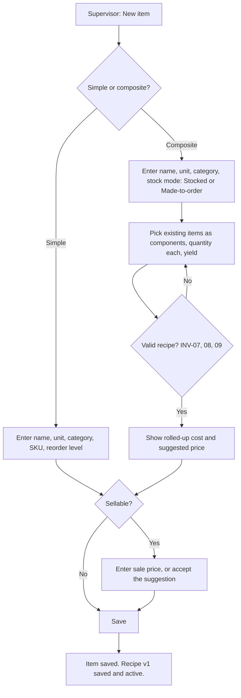
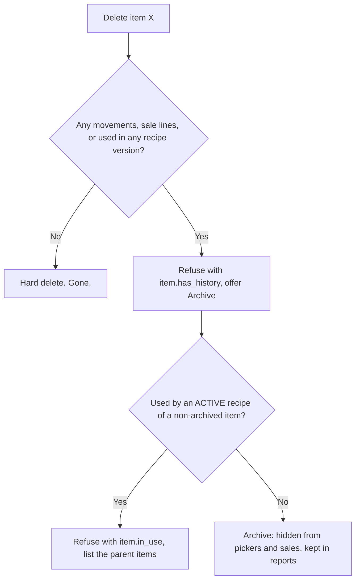
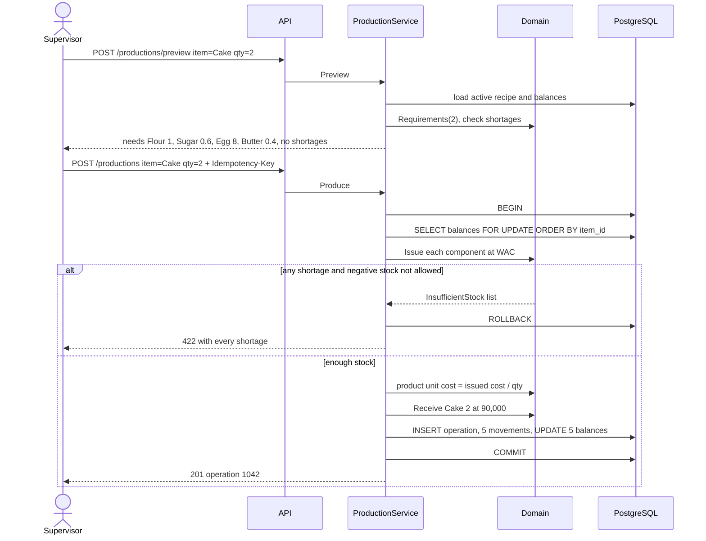

# 5. Business Processes

Each process lists who does it, the steps, the rules checked and the result. Rule IDs (INV-xx) refer to the [domain model](04-domain-model.md#44-invariants-catalogue).

## 5.0 Getting started: opening balances

On day one, the owner creates the simple items and enters what is already on the shelves. This is an **Adjustment** with reason `OpeningBalance` and the unit cost per item. It is the one adjustment that sets cost explicitly instead of using WAC. After that, stock only changes through the processes below.

## 5.1 Create an item



Rules: INV-01 to INV-05, plus INV-07 to INV-09 for composite items. Components are **always existing items** and are never copied, so Tea + Cake points to the same Piece of Cake that is sold on its own.

## 5.2 Edit an item, edit a recipe

- **Item details** (name, description, category, SKU, reorder level) are edited in place, guarded by the `xmin` concurrency token. If two people edit at once, the second gets "changed by someone else, reload".
- **Price** changes write to `item_price_changes`.
- **Unit** can change only while the item has no movements (INV-06).
- **Recipe**: "Edit" saves **a new version** and activates it in one transaction. The cycle check (INV-08) runs on the new lines. Operations already posted keep pointing to the version they used.

## 5.3 Delete or archive an item



## 5.4 Purchase (increase a simple item)

1. Supervisor enters the supplier (optional), the invoice number (optional) and lines of item, quantity and **unit price paid**.
2. Every item must be simple and stocked (INV-14).
3. In one transaction, for each line: `Receive(quantity, unit_price)` updates the WAC, and a movement is written with `unit_cost = price paid`.
4. Result: stock goes up, and **spend** for the period goes up by Σ quantity × price.

### How the weighted average cost moves

| Event | Quantity | Price paid | Calculation | Average cost after |
|---|---|---|---|---|
| Buy flour | 10 kg | 40,000 | first receipt | **40,000** |
| Buy flour | 5 kg | 46,000 | (10 × 40,000 + 5 × 46,000) ÷ 15 | **42,000** |
| Use 1 kg in production | −1 kg | — | issues never change the average | 42,000 |

If the balance is zero or below when stock arrives, the new price simply becomes the average.

## 5.5 Production (increase a composite item, consuming its components)



Rules:
- The item is composite, stocked, not archived and has an active recipe (INV-03, INV-10, INV-13, INV-20).
- Requirements are `line.quantity × quantity_to_make ÷ yield`.
- A made-to-order component inside the recipe is expanded into its own components (see §5.6).
- Balance rows are locked **in item-id order**, so two concurrent operations can never deadlock.
- The whole operation is one transaction (INV-16). The operation stores the recipe **version** used.

The resulting rows are in the [data model, §3.2](03-data-model.md#32-how-the-pieces-fit-the-cake-example-as-rows).

**Slicing a cake** is just another production. Piece of Cake has recipe "Cake 1, yield 8". Producing 8 pieces consumes 1 cake, and each piece costs 90,000 ÷ 8 = **11,250**.

## 5.6 Sale (decrease a stocked item, or consume a made-to-order item's components)

Staff enter lines of item, quantity, price (pre-filled from `sale_price`) and an optional discount.

**Made-to-order expansion** (recursive):

```
expand(item, qty):
    if item.stock_mode == Stocked: return [(item, qty)]
    result = []
    for line in item.active_recipe.lines:
        result += expand(line.component, line.quantity * qty / recipe.yield)
    return result
```

Movements are then **merged per item** (one movement per item per operation). The sale lines keep the detail of what the customer bought.

### Example: sale #1051

The customer buys 1 × Tea + Cake (made-to-order) and 2 × Piece of Cake.

**Sale lines (revenue and COGS)**

| item | qty | unit_price | unit_cost | net_amount | cost_amount | profit |
|---|---|---|---|---|---|---|
| Tea + Cake | 1 | 44,000 | 26,250 | 44,000 | 26,250 | 17,750 |
| Piece of Cake | 2 | 29,000 | 11,250 | 58,000 | 22,500 | 35,500 |
| **Total** | | | | **102,000** | **48,750** | **53,250** |

**Stock movements (what left the shelf)**

| item | quantity_delta | unit_cost |
|---|---|---|
| Piece of Cake | −3 (1 inside Tea + Cake, 2 sold alone) | 11,250 |
| Bottle of Tea | −1 | 15,000 |

The made-to-order line's `unit_cost` is the sum of its expanded components at WAC: 11,250 + 15,000 = 26,250.

## 5.7 Waste, adjustment, stock count

| Process | Steps | Value booked |
|---|---|---|
| **Waste** | Item, quantity, **reason** (expired, damaged, spilled, staff meal…) | Issued at WAC; reported as a loss by reason |
| **Adjustment** | Item, ± quantity, reason, note | At WAC (or a given cost for an opening balance) |
| **Stock count** | Supervisor counts items and enters the **counted quantity** and the time of the count | Variance = counted − balance *at the time of the count* (read from `balance_after` in the ledger, so sales during the count don't distort it). Booked at WAC with reason CountCorrection. Items with no variance get no movement. |

## 5.8 Reversal and correction

1. Choose an operation and click **Reverse** (Owner or Supervisor; a reason is required).
2. The system posts a **Reversal** operation with opposite movements at the **original unit costs**, and negative sale lines for sales (a refund).
3. It respects stock rules. Reversing the production of cakes that were already sold fails, because you can't un-make a sold cake.
4. **Correct** = reverse + post the fixed version, in one transaction. To the user it feels like "edit".

The average cost when a purchase is reversed:
`new_average = (Q × average − q × c) ÷ (Q − q)`, where Q is the current quantity and q, c are the reversed quantity and cost. If `Q − q ≤ 0` the average stays unchanged. If the result is below 0 it is clamped to 0, which is logged as a data anomaly.

## 5.9 Cost roll-up and suggested price

**Unit cost of an item**

- Simple item: its average cost, or its last purchase cost when the quantity is 0. If it has never been bought, the cost is unknown and is flagged.
- Composite item: Σ (line quantity × component unit cost) ÷ yield, recursively.

For suggested prices, composite items always roll up through the *current* recipe and *current* component costs, so the suggestion reflects today's ingredient prices.

**Suggested price** = cost ÷ (1 − target margin), rounded **up** to the rounding step (default 1,000).

| Item | Cost breakdown | Unit cost | Target margin | Raw price | Suggested | Actual margin |
|---|---|---|---|---|---|---|
| Cake | Flour 0.5 × 42,000 + Sugar 0.3 × 30,000 + Egg 4 × 5,000 + Butter 0.2 × 200,000 | 90,000 | — | — | (not sold whole) | — |
| Piece of Cake | Cake 1 × 90,000 ÷ 8 | 11,250 | 60% | 28,125 | **29,000** | 61.2% |
| Bottle of Tea | average purchase cost | 15,000 | — | — | sale price 20,000 | 25.0% |
| Tea + Cake | 11,250 + 15,000 | 26,250 | 40% | 43,750 | **44,000** | 40.3% |

Bought separately, a piece and a bottle cost 49,000, so the bundle saves the customer 5,000 and still earns a 40% margin.

**Margin warning (FR-PRC-05).** Suppose butter's average cost rises to 260,000. Then Cake costs 102,000, Piece of Cake costs 12,750, and the margin at 29,000 falls to 56.0%, below the 60% target. The item shows a warning with a new suggestion of 12,750 ÷ 0.4 = 31,875, rounded up to **32,000**.

*Margin and markup are different.* A 60% margin means price = cost ÷ 0.4 (2.5 × cost). A 60% markup would only be cost × 1.6. The system always uses **margin**.

## 5.10 What can I make?

For a composite item, the maximum quantity is `min over components of floor(available ÷ required per unit)`. It expands made-to-order components, and the component with the smallest result is reported as the **bottleneck**. For example: "You can make 5 cakes; butter is the limit (1.0 kg left, 0.2 kg per cake)."
