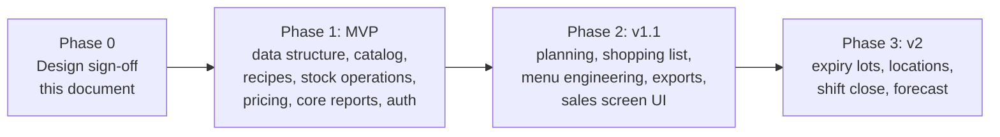

# 8. Features and Roadmap

Your requirements are covered in the MVP. The **added features** below are ones I propose because they solve real cafeteria problems. Each is marked with its value, its effort (S / M / L) and a phase. Tick or strike them during review.

## 8.1 Added features

| # | Feature | Problem it solves | Value | Effort | Phase |
|---|---|---|---|---|---|
| F-01 | **Made-to-order items** | Lattes and Tea + Cake are never "in stock". Selling them must consume the milk, coffee or cake directly. Resolves the v0.1 open question about bundles. | High | M | **MVP** |
| F-02 | **Recipe yield** | "1 tray = 24 cookies", "1 cake = 8 slices", without fractional recipe lines | High | S | **MVP** |
| F-03 | **Recipe versions** | Change a recipe without falsifying past costs and production history | High | S | **MVP** |
| F-04 | **Margin guard** | Ingredient prices rise quietly. Warn when an item's actual margin falls below its target, and suggest a new price. | High | S | **MVP** |
| F-05 | **Production preview and shortage list** | Know before you start that you are 5 eggs short | High | S | **MVP** |
| F-06 | **What can I make?** | "How many cakes can we bake right now, and what limits us?" | Medium | S | **MVP** |
| F-07 | **Waste tracking with reasons** | Waste is often the biggest hidden cost. See it by reason and item. | High | S | **MVP** |
| F-08 | **Stock counts with variance** | Find shrinkage (theft, unrecorded use, wrong recipes) | High | M | **MVP** |
| F-09 | **Reverse and correct instead of delete** | Fix mistakes without breaking reports or the audit trail | High | S | **MVP** |
| F-10 | **Idempotent sales** | A double tap or Wi-Fi retry never records a sale twice | High | S | **MVP** |
| F-11 | **Cost breakdown tree** | See which ingredient makes the cake expensive | Medium | S | **MVP** |
| F-12 | **Low-stock list and shopping list** | Items under their reorder level, with a suggested quantity to buy, grouped by supplier | High | S | v1.1 |
| F-13 | **Production planning** | Enter tomorrow's plan (5 cakes, 40 cookies) and get the total ingredients needed vs stock, which gives the shopping list | High | M | v1.1 |
| F-14 | **Supplier price history** | Last and average price per supplier; spot price jumps and compare suppliers | Medium | S | v1.1 |
| F-15 | **Purchase units** | Buy "1 box = 30 eggs" or "1 sack = 25 kg" while stocking in pieces or kg | Medium | S | v1.1 |
| F-16 | **Menu engineering matrix** | Classify sellable items as Stars (popular, profitable), Plowhorses (popular, low margin), Puzzles (profitable, unpopular) or Dogs, and decide what to promote, re-price or drop | High | M | v1.1 |
| F-17 | **Daily summary message** | Every evening the owner gets revenue, profit, waste and alerts by Telegram or email | Medium | S | v1.1 |
| F-18 | **CSV and Excel export** | Share with an accountant | Medium | S | v1.1 |
| F-19 | **Quick sales screen** | Big buttons, favourites, category tabs, for a tablet at the counter | High | M | v1.1 (frontend) |
| F-20 | **Expiry dates (lots)** | Use the oldest milk first, get "expires tomorrow" alerts, and reduce waste | High | L | v2 |
| F-21 | **Storage locations and transfers** | Fridge vs store room vs counter; know where things are | Medium | M | v2 |
| F-22 | **Shift close (Z-report)** | Expected vs counted cash per shift | Medium | M | v2 |
| F-23 | **Demand forecast** | Suggest the production quantity per weekday from past sales (Fridays sell 2× cake) | Medium | L | v2 |
| F-24 | **Barcode and SKU scanning** | Faster purchases and counts | Low | M | v2 |
| F-25 | **Multi-branch** | A second cafeteria, consolidated reports | Low | L | v3 |

## 8.2 Phases

### Proposed MVP build order (once you say go)

| Step | Deliverable | Done when |
|---|---|---|
| 1 | **Data structure**: domain entities, EF configurations, the initial migration with all constraints and seed units | Migration applies to PostgreSQL. Constraint tests pass: self-reference, positive quantity, one active recipe, MTO ⇒ composite. |
| 2 | Catalog + recipes (cycle check, versions, where-used, tree) | Unit + integration tests for INV-01 to INV-12 |
| 3 | Stock posting core (WAC, locking, ledger, balances) + purchases + adjustments | Concurrency test: 2 parallel issues of the last unit → exactly 1 succeeds |
| 4 | Production (+ preview, capacity) | Scenarios S-1, S-2 |
| 5 | Sales (+ made-to-order expansion), waste, stock count, reversal and correct | Scenarios S-3, S-4; reversal tests |
| 6 | Pricing: cost roll-up, suggested price, margin guard | Cake and Tea + Cake worked examples reproduce exactly |
| 7 | Reports + dashboard endpoints | P&L numbers match hand-calculated fixtures |
| 8 | Auth, roles, settings, Swagger, Docker Compose | Each endpoint's role policy is tested |
